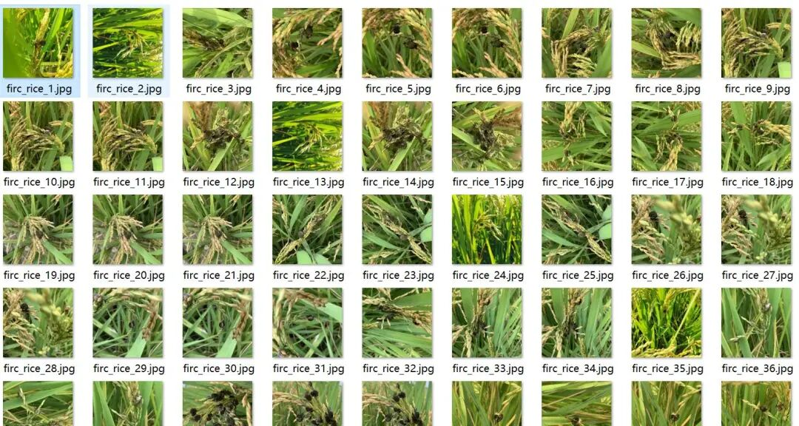
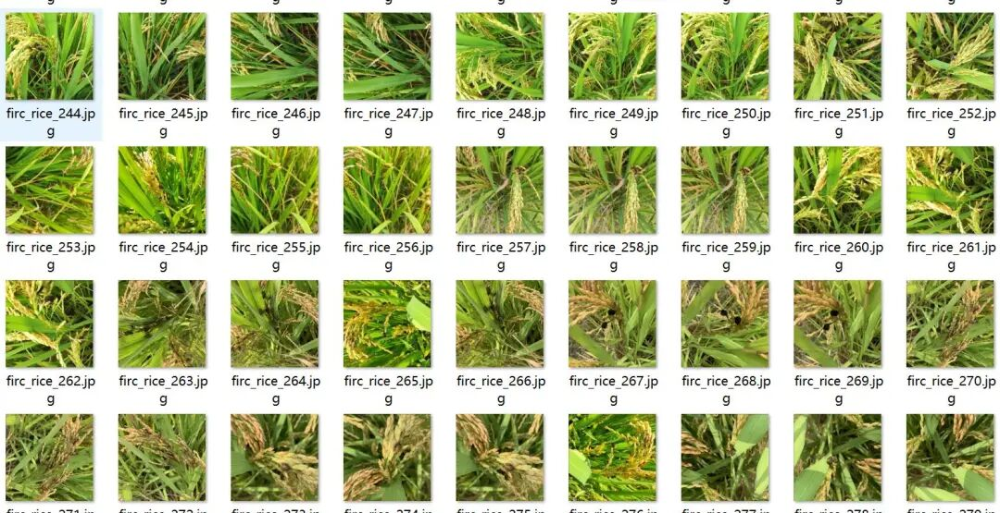
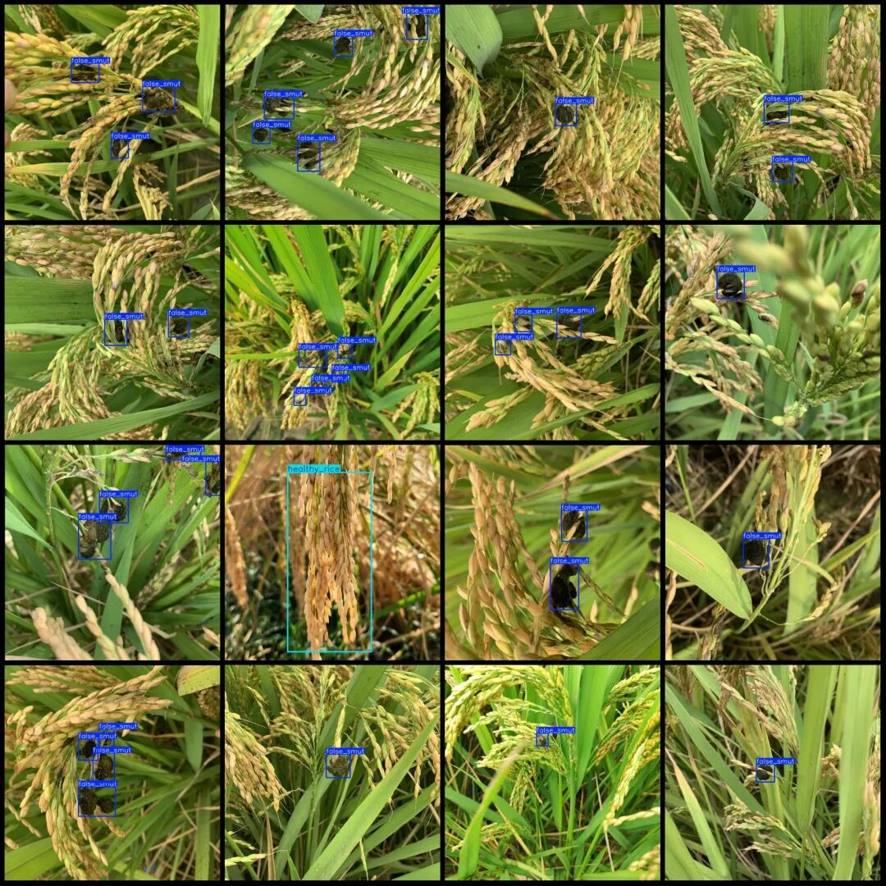
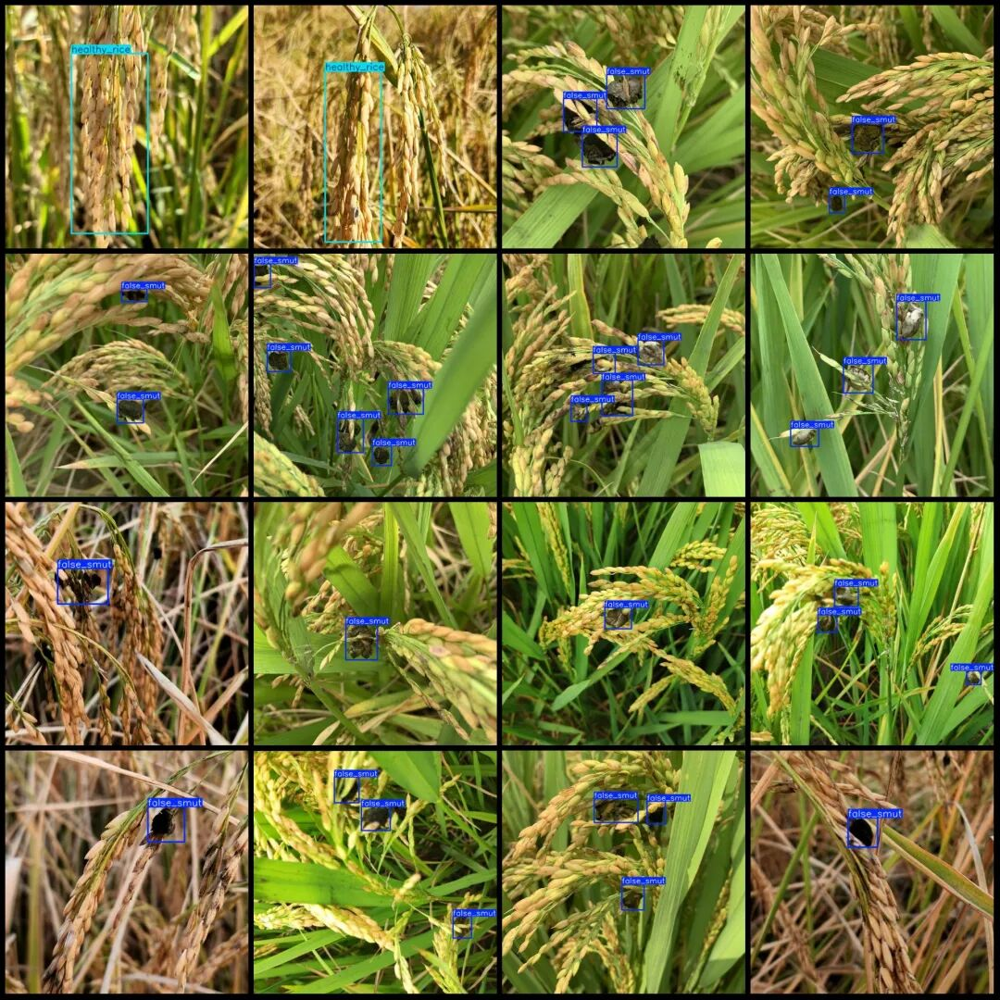

# Intelligent Agriculture Rice Blast Fungus Detection Dataset VOC+YOLO format with 3 categories, 357 images.

Please note that approximately 150 images in the dataset are original images, with the remaining being enhanced images, mainly rotation enhancement.

Dataset format: Pascal VOC format + YOLO format (txt file without split path, only containing jpg images and corresponding VOC format xml files and yolo format txt files)

Number of images (number of jpg files): 357

Number of annotations (number of xml files): 357

Number of annotations (number of txt files): 357

Label category count: 3

Label category names (Note that the order of Yolo format categories does not correspond to this, but is based on the labels folder's classes.txt): ["brown_spot", "false_smut", "healthy_rice"]

Number of boxes labeled in each category:

brown_spot (brown spot disease) frame count = 9

False Smut (rice blast) Frames = 758

Healthy rice (healthy rice) frame count = 34

Total frame count: 801

Number of images per category:

brown_spot (Brown Spot) occupies = 3

False Smut (Rice Blight) occupies 327 images.

Healthy Rice (Healthy Rice) occupies a picture count of 31.

Image resolution: 640x640

Using labelImg:

Annotation rules: Draw a rectangle around the category.

Important Notice: The dataset does not have separate training, validation, and test sets; you need to partition them yourself.

Special : This dataset does not guarantee the accuracy of the trained models or weight files.

Image Preview:

Annotation example:

## Payment

Here is a pay link on Stripe ( https://buy.stripe.com/3cs8yP7sY87d0vu9AB ). Please contact me lonlonago@foxmail.com after funding $89, and I will send you a complete data files , thank you!

